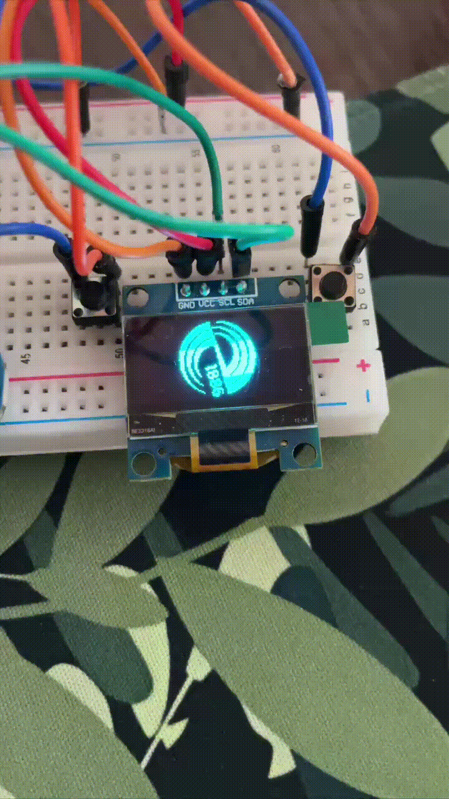

# STM32F401 OLED SSD1306 Smooth Logo Rotation

Анимация плавного вращения векторно-растрированного логотипа СПбГЭТУ «ЛЭТИ» (буква «е» с исторической надписью «1886») на монохромном графическом OLED-дисплее SSD1306 ($128 \times 64$) по интерфейсу $I^2C$ в режиме Fast Mode ($400\text{ кГц}$).

Разработано под  **STM32F401CCU6** («Black Pill») на базе **CMSIS**.

---

## 📺 Демонстрация работы
<p align="center">
  
</p>

## 🛠 Аппаратное подключение

| Дисплей OLED SSD1306 ($128 \times 64$) | STM32F401CCU6 (Black Pill) | Описание |
| :--- | :--- | :--- |
| **GND** | **GND** | Общий провод питания |
| **VCC** | **3.3V** | Питание дисплея |
| **SCL** | **PA8** (I2C3_SCL, AF4) | Тактовая линия $I^2C$ (Open-Drain + Pull-Up) |
| **SDA** | **PB4** (I2C3_SDA, AF9) | Линия данных $I^2C$ (Open-Drain + Pull-Up) |

---

## 📁 Структура проекта

```text
├── Inc/
│   ├── i2c.h                 # Инициализация I2C3 Fast Mode и функции записи
│   ├── init.h                # Конфигурация тактирования PLL 84 МГц и FPU
│   ├── logo_leti_anim_24.h   # Прототипы функций воспроизведения анимации
│   ├── main.h                # Основные заголовочные зависимости
│   ├── ssd1306.h             # Команды и базовая инициализация дисплея
│   └── systick.h             # Системный таймер и счетчик миллисекунд
├── Src/
│   ├── i2c.c                 # Реализация I2C3 на 400 кГц
│   ├── init.c                # Настройка HSE -> PLL -> 84 МГц, Flash Latency 2WS
│   ├── logo_leti_anim_24.c   # Массив 60 кадров во Flash и отрисовка
│   ├── main.c                # Точка входа main()
│   ├── ssd1306.c             # Инициализация контроллера SSD1306
│   └── systick.c             # Прерывание SysTick_Handler и delay_ms()
├── Startup/
│   └── startup_stm32f401ccux.s # Таблица векторов и ассемблерный стартап
├── STM32F401CCUX_FLASH.ld    # Скрипт компоновщика (Linker Script)
├── .cproject, .project       # Проектные файлы Eclipse / STM32CubeIDE
└── .gitignore                # Исключение сборочного мусора (Debug, .o, .elf)
```

---


